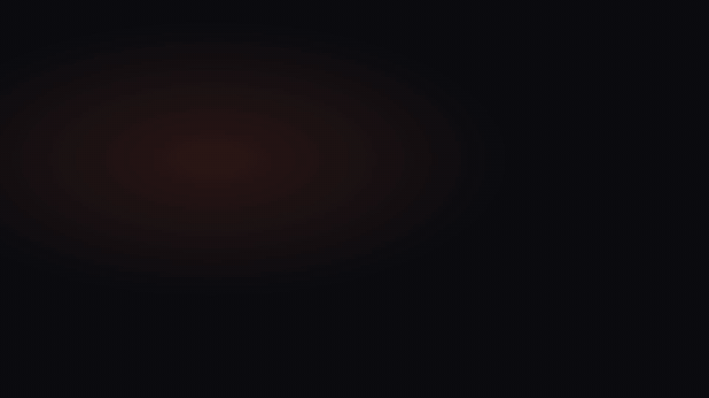

<p align="center">
  
</p>

<p align="center">
  <b>Motion graphics with Claude, on your machine.</b><br>
  Give it videos, images and your brand. Claude designs, animates and renders with Remotion.
</p>

<p align="center"><a href="README.md">Español</a></p>

---

## What it is

**Motion Architect** is a Claude Code agent for motion graphics. One install brings together the best design and animation skills out there, on top of a ready-to-use [Remotion](https://www.remotion.dev) studio:

| Piece | What it brings |
|---|---|
| **[Brag](https://github.com/latent-spaces/brag)** | Launch-video method: hook → reveal → highlights → punchline storyboard, tones, intentional audio |
| **[Emil Kowalski skills](https://github.com/emilkowalski/skills)** | Animation taste: easing, timing, springs, the invisible polish |
| **[UI/UX Pro Max](https://github.com/nextlevelbuilder/ui-ux-pro-max-skill)** | Styles, palettes, font pairings, visual hierarchy |
| **[watch](https://github.com/bradautomates/claude-video)** | Claude *watches* your reference videos (frames + transcript) |
| **[Remotion Agent Skills](https://github.com/remotion-dev/skills)** | Official Remotion best practices |
| **Motion Architect studio** | Remotion project with animated components, 4 formats, brand in one JSON |

Everything runs **locally**: rendering, video analysis and preview. Nothing gets uploaded.

<p align="center"></p>

## Install

Requirements: macOS or Linux, [Claude Code](https://claude.com/claude-code), Node 18+, ffmpeg, yt-dlp, Python 3. The installer checks everything and offers Homebrew installs on macOS.

```bash
git clone https://github.com/Hainrixz/motion-architect.git
cd motion-architect
./install.sh          # --yes for no prompts
```

It installs the Remotion studio, and in Claude Code: Motion Architect, Brag, UI/UX Pro Max, watch, Emil Kowalski's skills and Remotion's skills. It is idempotent. Restart Claude Code afterwards.

Optional: add `GROQ_API_KEY` or `OPENAI_API_KEY` to `~/.config/watch/.env` to transcribe videos without captions. Without it, Claude still sees the frames.

## Usage

```
/motion a 15s vertical reel announcing my finance app, cinematic style
```

Claude will: ask what's missing in one message → watch your references → set up your brand (`studio/brand.json`) → write a storyboard and wait for your OK → build the React/Remotion composition and review it against Emil's principles → open Remotion Studio (`cd studio && npm run studio`, http://localhost:3000) → render mp4s in the formats you asked for.

More prompts:
```
/motion animate my logo (~/Desktop/logo.svg), 5s, 16:9 and 9:16
Watch https://www.instagram.com/reel/... and make something with that rhythm in my brand. Vertical, 12s.
/motion-render MyVideo all
```

## Formats

| Format | Size | For |
|---|---|---|
| Vertical 9:16 | 1080×1920 | Reels, TikTok, Shorts |
| Landscape 16:9 | 1920×1080 | YouTube, web, decks |
| Square 1:1 | 1080×1080 | Feed, LinkedIn |
| Portrait 4:5 | 1080×1350 | Instagram feed |

## Credits & license

Each upstream piece is installed from its original repo under its own license. See [CREDITS.md](CREDITS.md). Motion Architect's code is **MIT**.

**Remotion licensing:** free for individuals, non-profits and companies of up to 3 people. Larger companies need a [company license](https://www.remotion.dev/license).
