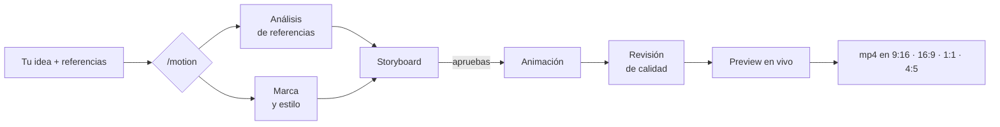

<p align="center">
  
</p>

<p align="center">
  <b>Motion graphics con Claude, en tu compu.</b><br>
  Le das videos, imágenes y tu marca. Claude diseña, anima y renderiza con Remotion.
</p>

<p align="center">
  <a href="#instalación">Instalación</a> ·
  <a href="#cómo-se-usa">Cómo se usa</a> ·
  <a href="#formatos">Formatos</a> ·
  <a href="#cómo-funciona-por-dentro">Cómo funciona</a> ·
  <a href="README.en.md">English</a>
</p>

<p align="center">
  
  
  
  
</p>

---

## Qué es

**Motion Architect** es un agente para Claude Code que hace motion graphics por ti. Le hablas como a un motion designer y te entrega el video renderizado.

| | |
|---|---|
| 👁 **Ve tus referencias** | Le pasas un video (link o archivo) o una imagen y entiende el ritmo, los cortes, la paleta y el tipo de movimiento |
| 🎨 **Diseña con tu marca** | Colores, tipografías y estilo visual, ya sea de tu marca o propuestos por él |
| 🎬 **Escribe el storyboard** | Hook, desarrollo y remate, con tiempos exactos. Tú lo apruebas antes de que se anime nada |
| ✨ **Anima con criterio** | Easing, timing y springs pensados para que se sienta profesional, no "hecho con IA" |
| 📐 **Renderiza en cualquier formato** | Vertical, horizontal, cuadrado o 4:5, con safe zones para Reels y TikTok |
| 🔊 **Pone sonido** | Librería de efectos incluida, sincronizados con la animación |

## La misión

Que cualquiera pueda hacer motion graphics de calidad hablando con Claude, como si tuviera un motion designer al lado. Sin After Effects y sin pelearse con keyframes. Le muestras un video que te gusta, le pasas tu logo y le dices *"algo así, pero para mi lanzamiento, en vertical"*.

Todo corre **en tu computadora**: el render, el análisis de videos y el preview. Nada se sube a ningún lado.

<p align="center">
  <br>
  <sub>Este demo salió del estudio incluido: <code>npx remotion render src/index.ts Demo-landscape</code></sub>
</p>

## Instalación

**Requisitos:** macOS o Linux, [Claude Code](https://claude.com/claude-code), Node 18+, ffmpeg, yt-dlp y Python 3. El instalador revisa todo y, en macOS, ofrece instalar con Homebrew lo que falte.

```bash
git clone https://github.com/Hainrixz/motion-architect.git
cd motion-architect
./install.sh
```

Eso es todo. El instalador revisa lo que falta, prepara el estudio de animación y deja el agente listo en Claude Code. Puedes correrlo varias veces sin problema, y con `./install.sh --yes` no te pregunta nada. Al terminar, reinicia Claude Code.

> **Repo privado:** mientras el repo sea privado, para clonarlo necesitas acceso en GitHub.

<details>
<summary><b>Opcional: transcripción de videos sin subtítulos</b></summary>

Motion Architect usa los subtítulos del video cuando existen. Para los que no tienen, puede transcribir el audio si agregas **una** de estas líneas en `~/.config/motion-architect/.env`:

```
GROQ_API_KEY=...
OPENAI_API_KEY=...
```

Sin llave, igual ve los frames del video, que es lo que importa para analizar movimiento.
</details>

## Cómo se usa

Abre Claude Code en la carpeta del repo (o en cualquier otra; el agente encuentra el estudio) y pide:

```
/motion un reel vertical de 15 s anunciando mi app de finanzas, estilo cinematic
```

Claude va a:

1. **Preguntarte lo que falte, todo en un mensaje:** formato, duración, tono, marca y música.
2. **Ver tus referencias:** videos (URL o archivo), imágenes y capturas.
3. **Armar tu marca:** colores, fuentes y estilo en `studio/brand.json`.
4. **Escribir el storyboard** y esperar a que lo apruebes.
5. **Construir la animación** y revisarla cuadro por cuadro antes de mostrártela.
6. **Abrir Remotion Studio** en `localhost:3000` para que veas el preview y lo ajustes.
7. **Renderizar** el mp4 en los formatos que pediste, con poster.

### Ejemplos de prompts

```
/motion anima mi logo (está en ~/Desktop/logo.svg), 5 segundos, 16:9 y 9:16
```
```
Mira este video https://www.instagram.com/reel/... y hazme algo con ese ritmo
pero con mi marca. Vertical, 12 s.
```
```
/motion intro para mi canal de YouTube, estilo editorial, colores de esta imagen: ./captura.png
```
```
/motion un dato animado: "pasamos de 0 a 10,000 usuarios en 30 días", 4:5 para el feed
```
```
/motion-render MiVideo all
```

### Preview en vivo

```bash
cd studio && npm run studio     # → http://localhost:3000
```

Ahí ves cada composición en cada formato, puedes scrubbear el timeline y los cambios que hace Claude aparecen al instante.

## Formatos

| Formato | Tamaño | Para |
|---|---|---|
| **Vertical** 9:16 | 1080×1920 | Reels, TikTok, Shorts, Stories |
| **Horizontal** 16:9 | 1920×1080 | YouTube, web, presentaciones |
| **Cuadrado** 1:1 | 1080×1080 | Feed, LinkedIn |
| **Feed** 4:5 | 1080×1350 | Feed de Instagram |

Todo se diseña con unidades relativas, así que una misma animación se adapta a los cuatro. Las safe zones de Reels y TikTok ya vienen respetadas.

## Cómo funciona por dentro



```
motion-architect/
├─ install.sh                    instalador de un comando
├─ .claude-plugin/               plugin de Claude Code
├─ skills/motion-architect/      el agente: método, motores de visión y diseño, criterio de animación
├─ agents/reference-analyst.md   subagente que analiza videos de referencia
├─ commands/                     /motion y /motion-render
└─ studio/                       proyecto Remotion
   ├─ brand.json                 tu marca: colores, fuentes, estilo
   ├─ src/components/            KineticTitle, LogoReveal, Counter, CardStack, Caption, ImagePan…
   ├─ src/lib/motion.ts          curvas de easing y springs
   ├─ src/compositions/          tus videos (Demo incluido)
   └─ public/                    referencias, música, SFX, logos
```

## Licencia

Motion Architect es **MIT**. Los componentes open source incluidos están listados en [third_party/NOTICES.md](third_party/NOTICES.md).

**Ojo:** el motor de video es [Remotion](https://www.remotion.dev), que es gratis para personas, organizaciones sin fines de lucro y empresas de hasta 3 personas. Las empresas más grandes necesitan una [licencia de empresa](https://www.remotion.dev/license). Revisa sus términos antes de usarlo comercialmente.

---

<p align="center"><sub>Hecho por <a href="https://github.com/Hainrixz">Enrique Rocha</a> · Tododeia</sub></p>
